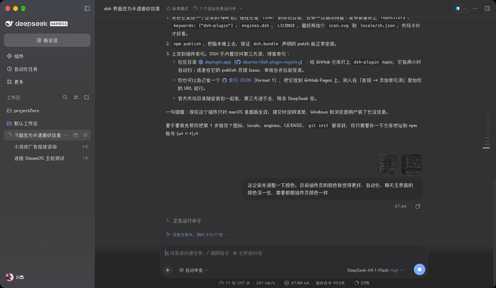

# dsh-frosted-glass

**English** | [中文](README.zh.md)

Native macOS frosted glass for the [DeepSeek Harness](https://github.com/deepseek-ai/deepseek-harness) Desktop window —
the UI's panes show the window's real vibrancy material instead of painting over it.



## What it does

The Desktop shell already asks macOS for a native material and a transparent window
(`vibrancy: "sidebar"`, `backgroundColor: "#00000000"`). The Web GUI then paints every pane opaque,
so the material never shows. This plugin re-tints those panes with an alpha color:

- the window reads as one piece of frosted glass, and the blur stays **native** — macOS composites it,
  so nothing is re-blurred per frame in CSS;
- the conversation, the schedule page and the plugin page sit at the same depth (each of them used to
  add its own opaque layer on top of the layout);
- page-style surfaces lose the sticky header strip that turned one step darker than the body once the
  tint became translucent.

## Requirements

| | |
|---|---|
| Host | DSH Desktop **on macOS** (`dsh >= 0.2.0-rc.1`) |
| Not supported | the Web GUI in a browser tab — there is no window material to show through |

It also honours the system **Reduce transparency** setting and macOS full-screen mode by falling back
to solid surfaces, the way native apps do.

## Install

From the plugin page (**插件 → 添加插件**), install it by spec:

- npm: `dsh-frosted-glass`
- a checkout: `file:/absolute/path/to/dsh-frosted-glass`

Then toggle **frosted-glass** on. The page reloads the module; no app restart is needed.

To remove it, toggle the bundle off or remove it from the plugin page.

## Tuning

The plugin ships two knobs, both in the stylesheet at the top of `lib/client.js` — the percentage is
opacity, so a lower number is more transparent:

```css
--dsh-frosted-glass-pane: color-mix(in srgb, #fdfdff 56%, transparent);  /* light theme */
--dsh-frosted-glass-pane: color-mix(in srgb, #151517 44%, transparent);  /* dark theme  */
```

The sidebar has its own alpha, since macOS already mixes the sidebar fill with 50% transparency:

```css
--dsw-specific-sidebar-fill: color-mix(in srgb, #f9fafb 50%, transparent);
```

Edit the file, then toggle the plugin off and on to reload it.

## How it works

A bundle can ship both a host half and a browser half, so this one package is enough:
`dsh.bundle` points at `cordis.patch.yml` (which adds one Loader row) and `dsh.client` points at the
browser bundle. The browser half appends one `<style>` element when the module materializes.

Everything is selector-driven, never a patched app binary:

- `--dsw-alias-bg-base` is the token every pane paints, so tinting that one variable makes the window glass;
- `html[data-platform="darwin"]` keeps it inert on other platforms;
- pane-level layers that paint the same token again (conversation root, page roots, tab hosts) are set
  transparent, so every main surface keeps exactly one tint layer.

## Limitations

- macOS Desktop only; Windows and the browser get no visual change.
- The selectors use CSS-module **local names** (`pageBar`, `pageBody`, `TabHost`, the conversation's
  column-width custom property), not hashed class names, so they survive rebuilds — but a major layout
  refactor can still break them.
- macOS "Reduce transparency" and full screen win over the plugin by design.

## License

[MIT](LICENSE)
