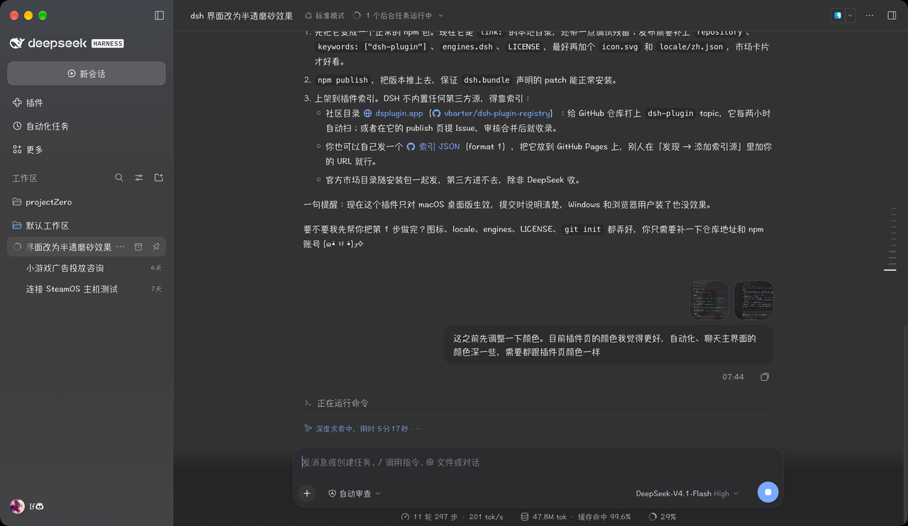

# dsh-frosted-glass

[English](README.md) | **中文**

把 [DeepSeek Harness](https://github.com/deepseek-ai/deepseek-harness) 桌面版的窗口变成 macOS 原生那种半透磨砂 ——
界面不再把窗口盖成实色，而是让原生材质透出来。



## 它做了什么

桌面端建窗口时本来就要了 macOS 的原生材质和透明背景（`vibrancy: "sidebar"`、`backgroundColor: "#00000000"`），
但 Web 界面把每一块面板都刷成了实色，材质就被盖住了。这个插件只做三件事：

- 把这些面板换成带透明度的 tint，整个窗口变成一块玻璃，模糊仍然由 **macOS 原生合成**，CSS 不逐帧重新模糊；
- 让聊天、自动化任务、插件页落在同一层深度（它们原来各自在布局底色上又叠了一层）；
- 去掉页面型界面那条吸顶标题的遮罩 —— 磨砂化之后它会比正文深一档，怎么调都对不上。

## 环境要求

| | |
|---|---|
| 宿主 | **macOS 上的 DSH 桌面版**（`dsh >= 0.2.0-rc.1`） |
| 不支持 | 浏览器标签页里打开的 Web 界面 —— 那里没有窗口材质可透 |

系统开了「降低透明度」、或者窗口进入全屏时，插件会退回实色，跟原生 App 的行为一致。

## 安装

在插件页（**插件 → 添加插件**）里按 spec 安装：

- npm：`dsh-frosted-glass`
- 本地源码：`file:/你的绝对路径/dsh-frosted-glass`

然后在插件列表里打开 **frosted-glass** 开关即可，页面会重新加载插件模块，不用重启 App。

不想要了就把开关关掉，或在插件页把它移除。

## 调浓淡

`lib/client.js` 顶部那段样式表里有两组旋钮，百分比是不透明度，数字越小越透：

```css
--dsh-frosted-glass-pane: color-mix(in srgb, #fdfdff 56%, transparent);  /* 浅色主题 */
--dsh-frosted-glass-pane: color-mix(in srgb, #151517 44%, transparent);  /* 深色主题 */
```

侧栏单独一档（macOS 原本就会把侧栏底色再和 50% 透明混一次）：

```css
--dsw-specific-sidebar-fill: color-mix(in srgb, #f9fafb 50%, transparent);
```

改完把插件关一下再打开就会重新加载。

## 实现方式

一个包里同时放 host 半边和浏览器半边就够了：`dsh.bundle` 指向 `cordis.patch.yml`（往 Loader 里插一行），
`dsh.client` 指向浏览器 bundle。模块物化时，浏览器半边往 `<head>` 里追加一个 `<style>`。

全程只靠选择器，不改安装包里的任何二进制：

- 所有面板都刷 `--dsw-alias-bg-base` 这个 token，所以只改它一个变量就能让窗口变玻璃；
- `html[data-platform="darwin"]` 保证其他平台完全不受影响；
- 那些在布局底色上又刷一层同 token 的面板级容器（会话根节点、页面根节点、标签栏宿主）被设成透明，
  保证每个主界面只留一层 tint。

## 已知限制

- 只对 macOS 桌面版生效，Windows 和浏览器里没有任何变化。
- 选择器用的是 CSS Module 的**局部类名**（`pageBar`、`pageBody`、`TabHost`，以及会话的列宽自定义属性），
  不是哈希类名，重建不会失效；但大改版式的版本仍有可能打破它。
- 系统的「降低透明度」和全屏模式优先级更高，这是有意为之。

## 许可

[MIT](LICENSE)
